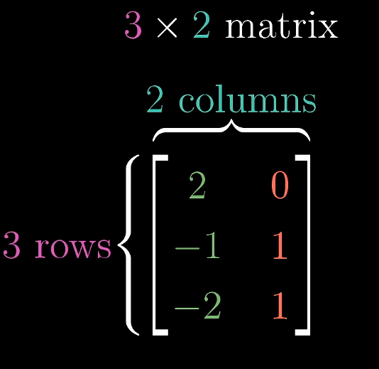
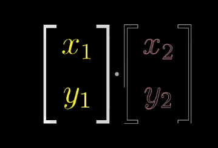
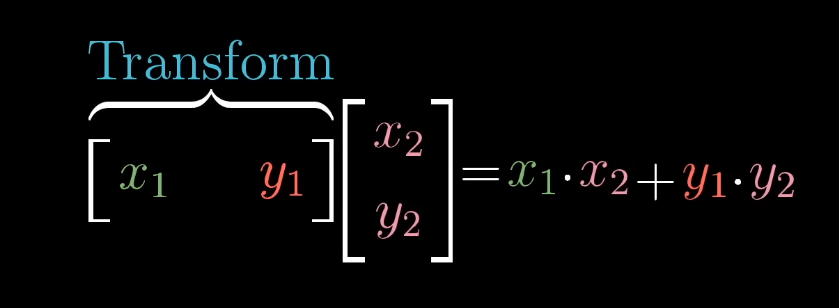
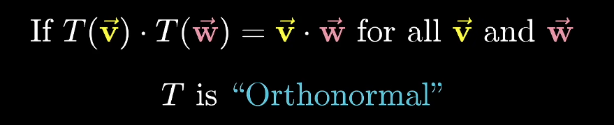
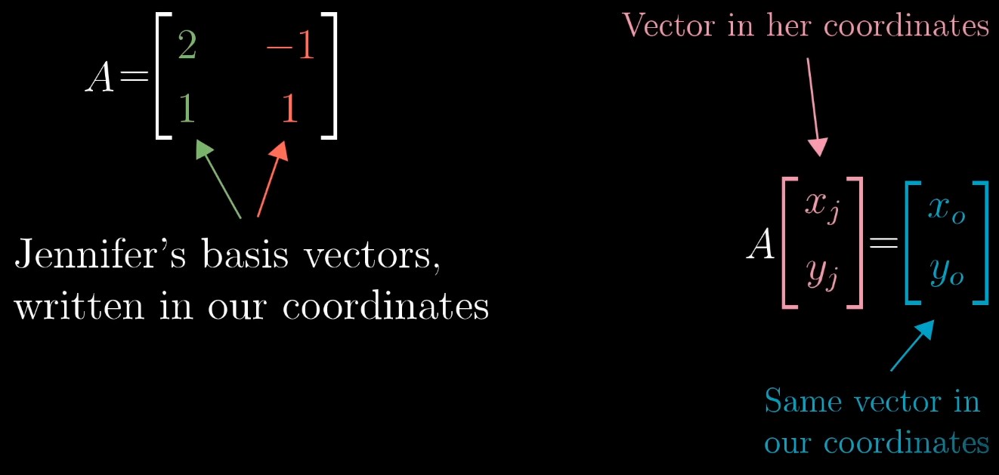

## Linar Transformations

Two properties:

1. Origin is fixed.
2. Grid lines remain parallel and evenly spaced.

## Matrixes

Think of matrixes as linear transformations.

Determinants are how much a unit area is stretched by the matrix transformation. The sign of determinant indicates the orientation change (right-hande rule).

## Inverse matrices, column space and null space  

- Inverse Matrix $A^{-1}$

  This is the reverse transform of the original matrix $A$. The inverse matrix $A^{-1}$ exists if $det(A)!=0$.   

- Column Space

  The set of all possible outputs $A\vec{x}$ is the column space of $A$. The span of the columns is the column space.

- Null Space or kernel of the matrix $A$
  
  For $A\vec{x} = \vec{v}$, all $\vec{x}$ which lead to $\vec{v}=\vec{0}$ is the null space or kernel of the matrix $A$.

- Matrix Rank

  The rank is the number of dimentions in the column space. For $A\vec{x} = \vec{v}$,  full rank means the output dimention $\vec{v}$ is the same with the input dimention $\vec{x}$.

## Nonsquare matrices as transformations between dimensions

Take the following 3*2 matrix for example, 

This matrix has two basis vectors of dimention $3$. It is transforming a vector in 2D space to a vector in 3D space. The transformed vectors are in a plane of the 3D space. The number of dimentions in the matrix's column space is the same as the number of dimentions in the input space. So the matrix is still full rank.

## Dot products and duality

A dot product of two vectors can be throught as linar transformation which transforms one vector to one dimentional space.

From 

to 

## Cross-products

## Cramer's rule

Orthonormal Matrix (Rotation Matrix) has the following properties:

Think about the following example.

$$
\begin{bmatrix}
\cos(30^\circ) & -\sin(30^\circ) \\
\sin(30^\circ) & \cos(30^\circ)
\end{bmatrix}
\begin{bmatrix} x \\ y \end{bmatrix}
=
\begin{bmatrix} 1 \\ 2 \end{bmatrix}
$$

where 

$$
A = \begin{bmatrix}
\cos(30^\circ) & -\sin(30^\circ) \\
\sin(30^\circ) & \cos(30^\circ)
\end{bmatrix}
$$

We are using the transformation $A$ to transform $[x, y]^T$ to $[x, y]^T$. Since the transformation matrix is orthonormal, the following condition holds:

$$
\begin{bmatrix} x \\ y \end{bmatrix} \cdot \begin{bmatrix} 1 \\ 0 \end{bmatrix} =
A \times \begin{bmatrix} x \\ y \end{bmatrix} \cdot A \times \begin{bmatrix} 1 \\ 0 \end{bmatrix} =
\begin{bmatrix} 1 \\ 2 \end{bmatrix} \cdot \begin{bmatrix}
\cos(30^\circ) \\ \sin(30^\circ)
\end{bmatrix}
$$

so 

$$
x = \begin{bmatrix} 1 \\ 2 \end{bmatrix} \cdot \begin{bmatrix}
\cos(30^\circ) \\ \sin(30^\circ)
\end{bmatrix}
$$

Similarly,

$$
y = \begin{bmatrix} 1 \\ 2 \end{bmatrix} \cdot \begin{bmatrix}
-\sin(30^\circ) \\ \cos(30^\circ)
\end{bmatrix}
$$

But orthonormal matrix is a special case, what about general matrix?

Take the following for example:

$$
\begin{gathered}
\begin{bmatrix}
2 & -1 \\
0 & 1
\end{bmatrix}
\begin{bmatrix} x \\ y \end{bmatrix}
=
\begin{bmatrix} 4 \\ 2 \end{bmatrix}
\\ \\
A = \begin{bmatrix}
2 & -1 \\
0 & 1
\end{bmatrix}
\end{gathered}
$$

## Change of Basis

## Eigen Vectors and Eigen Values

Most vectors get knocked off their span during a linear transformation. Eigenvectors are the special vectors that remain on their own span, they only get stretched or squished. The eigenvalue is the factor by which an eigenvector is stretched or squished (it can be negative or fractional).

For example, the matrix below stretches all vectors on the x-axis by a factor of 3, and all vectors on the line spanned by $[-1, 1]^T$ by a factor of 2.

$$
A = \begin{bmatrix}
3 & 1 \\
0 & 2
\end{bmatrix}
$$

For a 3D rotation, the eigenvector is the axis of rotation, and its eigenvalue is 1 since rotations do not change lengths.

- Computing eigenvalues and eigenvectors

  Symbolically, an eigenvector $\vec{v}$ with eigenvalue $\lambda$ satisfies:

  $$
  A\vec{v} = \lambda\vec{v} \;\Rightarrow\; (A - \lambda I)\vec{v} = \vec{0}
  $$

  For a non-zero $\vec{v}$ to be sent to $\vec{0}$, $A - \lambda I$ must squish space into a lower dimension, which means:

  $$
  \det(A - \lambda I) = 0
  $$

  For the example above, $(3-\lambda)(2-\lambda) = 0$, so $\lambda = 2$ or $\lambda = 3$. Plug each $\lambda$ back in and solve $(A - \lambda I)\vec{v} = \vec{0}$ to get the eigenvectors.

- Special cases

  1. 90° rotation $\begin{bmatrix} 0 & -1 \\ 1 & 0 \end{bmatrix}$: $\lambda^2 + 1 = 0$ has only imaginary roots $\pm i$, so there are no real eigenvectors.
  2. Shear $\begin{bmatrix} 1 & 1 \\ 0 & 1 \end{bmatrix}$: the only eigenvalue is 1, and only the vectors on the x-axis are eigenvectors.
  3. Scaling by 2: the only eigenvalue is 2, but every vector is an eigenvector.

- Eigenbasis

  An eigenbasis is a set of basis vectors which are also eigenvectors.

  1. Standard basis vectors are eigenvectors $\Rightarrow$ diagonal matrix

     The columns of a matrix are where the basis vectors land. If $\hat{i}$ and $\hat{j}$ (standard basis) are eigenvectors, they are only scaled: $A\hat{i} = \lambda_1\hat{i} = [\lambda_1, 0]^T$ and $A\hat{j} = \lambda_2\hat{j} = [0, \lambda_2]^T$. So the matrix is diagonal with the eigenvalues on the diagonal:

     $$
     D = \begin{bmatrix} \lambda_1 & 0 \\ 0 & \lambda_2 \end{bmatrix}
     $$

     Diagonal matrices are easy to work with, e.g. $D^{100}$ is just each diagonal entry raised to the 100th power.

  2. Eigenvectors are not the standard basis $\Rightarrow$ change basis

     If there are enough eigenvectors to span the space, put them as the columns of the change of basis matrix $P$, and the corresponding eigenvalues (in the same order) on the diagonal of $D$. For the example $A$ above, with eigenvectors $[1, 0]^T$ ($\lambda = 3$) and $[-1, 1]^T$ ($\lambda = 2$):

     $$
     P = \begin{bmatrix} 1 & -1 \\ 0 & 1 \end{bmatrix}, \quad
     P^{-1} = \begin{bmatrix} 1 & 1 \\ 0 & 1 \end{bmatrix}, \quad
     D = \begin{bmatrix} 3 & 0 \\ 0 & 2 \end{bmatrix}
     $$

     Then:

     $$
     A = PDP^{-1} \quad \Leftrightarrow \quad D = P^{-1}AP
     $$

     Why it holds: $A$ applied to each column of $P$ gives $\lambda_i\vec{v}_i$, and $D$ applied on the right of $P$ scales each column of $P$ by $\lambda_i$. So $AP = PD$, and multiplying both sides by $P^{-1}$ on the right gives $A = PDP^{-1}$.

  3. Geometric view of $A = PDP^{-1}$

     Read $PDP^{-1}\vec{x}$ from right to left:

     1. $P^{-1}$: translate $\vec{x}$ from standard coordinates into eigenbasis coordinates. $x = Px'$: this translates eigenbasis cooridnates $x'$ to standard coordinates $x$. As a result, $P^{-1}x$ translates standard coordinates into eigenbasis coordinates.
     2. $D$: in the eigenbasis, the transformation only scales each coordinate by its eigenvalue.
     3. $P$: translate the result back into standard coordinates.

     Taking this detour gives the same result as applying $A$ directly. $A$ and $D$ describe the same transformation, just seen from two different coordinate systems.

  4. Why it eases computation

     The $P^{-1}P$ pairs in the middle cancel out:

     $$
     A^n = (PDP^{-1})(PDP^{-1})\cdots(PDP^{-1}) = PD^nP^{-1}
     $$

     For the example above:

     $$
     A^n = \begin{bmatrix} 1 & -1 \\ 0 & 1 \end{bmatrix}
     \begin{bmatrix} 3^n & 0 \\ 0 & 2^n \end{bmatrix}
     \begin{bmatrix} 1 & 1 \\ 0 & 1 \end{bmatrix}
     = \begin{bmatrix} 3^n & 3^n - 2^n \\ 0 & 2^n \end{bmatrix}
     $$

  Not every transformation has an eigenbasis, e.g. a shear does not have enough eigenvectors to span the full space, so no invertible $P$ can be built.

## References

1. [3Blue1Brown](https://youtu.be/PFDu9oVAE-g?si=pMQHEo7CZ41-ls_i)

## Todo

- Finish the last two videos