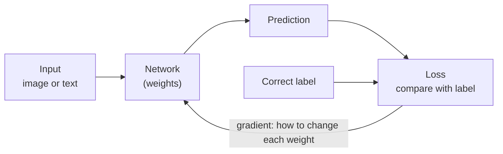
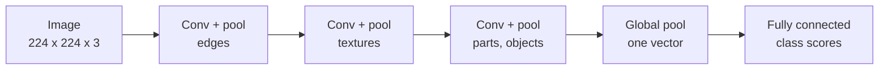
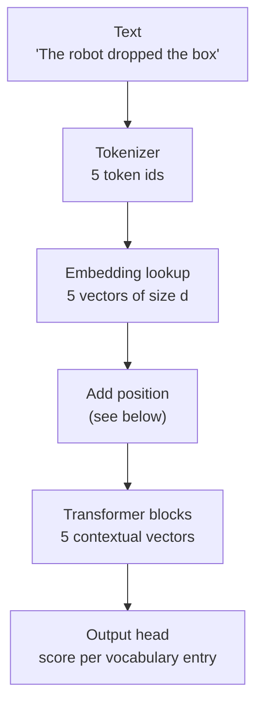
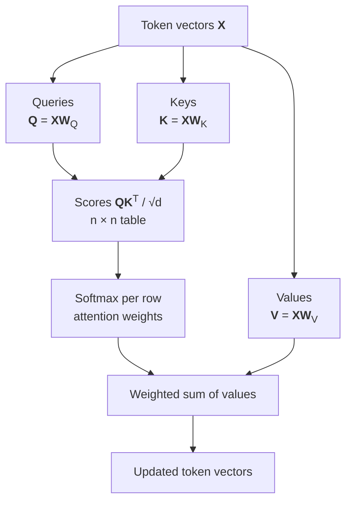
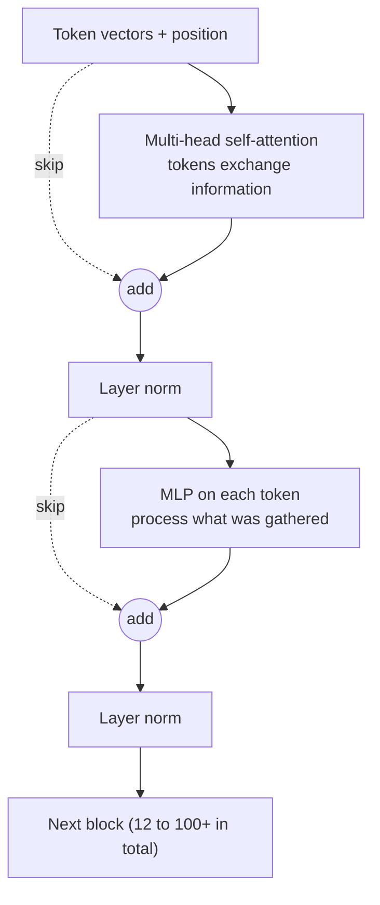

* TOC
{:toc}

## Overview

Almost every modern perception model, and every large language model, is built from one of two families of neural networks, or a mix of both:

- **Convolutional neural networks (CNNs)** slide a small learned pattern detector over an image. They dominated computer vision from AlexNet (2012) to around 2020 and still run on most robots and phones.
- **Transformers** let every piece of the input look at every other piece and decide what matters. They were introduced for translation in 2017 ("Attention Is All You Need"), took over language (GPT, Claude, Gemini), and then vision (Vision Transformer, 2020).

This post explains both from scratch, for a reader who has not worked with neural networks before. The one idea to keep in mind throughout: **both networks turn an input into a grid or list of number vectors, and repeatedly update each vector using information from other vectors. They differ in which other vectors each one is allowed to look at.** A CNN looks at its immediate neighbors. A Transformer looks at everything, and learns where to look.

## What a neural network does

A neural network is a function with millions of adjustable numbers, called **weights** or **parameters**. It takes numbers in (pixel brightness, word ids) and produces numbers out (a score for "cat", the probability of the next word).

The basic building block is a **layer**: multiply the input vector by a weight matrix, add a bias, then apply a simple nonlinearity such as ReLU, $\max(0, x)$. Stacking many layers lets the network represent very complicated functions. Without the nonlinearity, a stack of layers would collapse into a single matrix multiplication.

**Training** means finding good weights. Show the network an example, compare its output with the correct answer using a **loss** (a number that is large when the output is wrong), compute how each weight should change to reduce the loss (backpropagation, which is the chain rule of calculus), and nudge every weight a little in that direction (gradient descent). Repeat over millions of examples. Nobody writes the edge detectors or grammar rules by hand: they emerge because they help reduce the loss.

A plain network where every input number connects to every output number is called **fully connected** (or a multilayer perceptron, MLP). It works for small inputs but breaks down for images, which is where CNNs come in.

## Convolutional neural networks

### Why not a fully connected network for images

A small color image of 224 x 224 pixels has $224 \times 224 \times 3 = 150{,}528$ numbers. A fully connected layer to just 1000 hidden units needs 150 million weights, for one layer. Worse, it learns nothing reusable: a weight that detects a vertical edge in the top-left corner says nothing about a vertical edge in the bottom-right, so the network must learn the same pattern separately at every location.

Images have two properties a better design can exploit:

- **Locality.** A pixel is strongly related to its neighbors and barely related to a pixel on the other side of the image. Edges, corners and textures are small.
- **Translation.** A cat is a cat whether it sits on the left or the right. The same pattern detector should work everywhere.

### Convolution: a small detector that slides

A **convolution** takes a small grid of weights, the **kernel** or **filter** (typically 3 x 3), places it on the image, multiplies each pixel under it by the matching weight, and sums the nine products into one output number. Then it slides one pixel over and repeats. The output is a new grid, the **feature map**, whose value at each location says "how strongly does this patch look like my pattern?".



Try the figure: the vertical edge kernel is $[-1, 0, 1]$ in every row, so it computes "pixel values on the right minus pixel values on the left". It is zero on flat regions and large on vertical edges. The horizontal edge kernel does the same top to bottom, and the blur kernel averages the patch.

The key point is that in a CNN, **the nine kernel weights are learned**, not designed. A convolutional layer has many kernels (32, 64, 512), each producing its own feature map, so the output of a layer is a stack of feature maps called **channels**. The first layer of a trained CNN typically learns edge and color detectors very similar to the ones above.

Compare the cost: a layer of 64 kernels of size 3 x 3 over a 3-channel image has $64 \times 3 \times 3 \times 3 = 1728$ weights, instead of 150 million. This works because of two built-in assumptions:

- **Local connectivity**: each output looks only at a small neighborhood.
- **Weight sharing**: the same kernel is reused at every location.

Together they give **translation equivariance**: shift the input image by 5 pixels and the feature map shifts by 5 pixels, with the same values. An edge detector learned on one part of the image works on all of it.

### Stacking layers: from edges to objects

One 3 x 3 kernel only sees 3 x 3 pixels. A second convolution on top of the first sees 3 x 3 *feature map* cells, each of which already summarizes 3 x 3 pixels, so it effectively sees 5 x 5 pixels. The region of the input that can influence one output is its **receptive field**, and it grows with depth. (The interactive figure in the [comparison section](#how-they-compare) shows this.)

To grow it faster, CNNs periodically **downsample**:

- **Pooling**: replace each 2 x 2 block by its maximum (max pooling) or average. This halves the width and height.
- **Strided convolution**: move the kernel 2 pixels at a time instead of 1.

Each downsampling step halves the resolution and usually doubles the number of channels. The network trades "where exactly" for "what". Visualizations of trained CNNs ([Olah et al., Feature Visualization](https://distill.pub/2017/feature-visualization/)) show the resulting hierarchy: early layers respond to edges and colors, middle layers to textures and repeated patterns, late layers to object parts (eyes, wheels) and whole objects.

### A complete CNN classifier

Classic examples, in historical order: LeNet (1998, handwritten digits), AlexNet (2012, the ImageNet breakthrough that started the deep learning era), VGG (2014, only 3 x 3 convolutions), ResNet (2015, **skip connections** that add a block's input to its output, which made networks with 100+ layers trainable; Transformers use the same trick), MobileNet and EfficientNet (efficient CNNs for phones and embedded devices).

Replace the classifier head and the same backbone does other tasks: a detection head outputs boxes (YOLO, Faster R-CNN), a segmentation head outputs a label per pixel (U-Net), a depth head outputs a depth per pixel. In robotics, CNNs also run on bird's-eye view grids built from LiDAR, as in the [LiDAR perception post](/2026/11/11/lidar-perception-from-raw-points-to-tracked-obstacles/).

### Strength and limit

The strength of a CNN is its assumptions: locality and weight sharing are correct for natural images, so the network does not have to learn them from data. This is called an **inductive bias**. It makes CNNs data efficient and cheap: the cost grows linearly with the number of pixels.

The limit is the same assumptions. Two distant parts of the image can only interact after many layers, once their receptive fields overlap. Relationships that span the whole image ("the person at the left is holding the leash attached to the dog at the right") are hard to capture early. And the kernel weights are fixed after training: the same filter is applied regardless of what the image contains.

## Transformers

### Tokens and embeddings: everything becomes a list of vectors

A Transformer never sees raw text or pixels. Its input is a **sequence of tokens**, and each token is represented by a vector of numbers called its **embedding**. For text, getting there takes two steps.

**Step 1: tokenization, text to integer ids.** A **tokenizer** splits the text into pieces from a fixed **vocabulary** and replaces each piece by its index in that vocabulary, the **token id**. The pieces are neither whole words nor single characters but **subwords**: frequent words get their own token ("robot"), rare words are split into frequent fragments ("Transformers" becomes "Transform" + "ers"). This is a compromise. A word-level vocabulary cannot represent new words, names or typos, and a character-level one makes sequences very long, which is expensive because attention compares every token with every other. The vocabulary is built once, before training, by starting from single characters (or bytes) and repeatedly merging the most frequent adjacent pair in a large text corpus (byte-pair encoding, BPE, or a close variant). Typical vocabularies have 30,000 to 200,000 entries, and one English token is on average about three quarters of a word.

| Piece | `The` | `·robot` | `·dropped` | `·the` | `·box` |
| --- | --- | --- | --- | --- | --- |
| Token id | 464 | 9379 | 5710 | 262 | 3091 |

(The ids are made up for illustration; `·` marks a leading space, which most tokenizers keep as part of the token.)

A token id is only a name. Id 9379 is not "larger" than id 464 in any meaningful way, so the network cannot compute with it directly.

**Step 2: embedding lookup, id to vector.** The model holds an **embedding table**: a matrix $\mathbf{E}$ with one row per vocabulary entry and $d$ columns, where $d$ is the model width (768 in BERT-base and GPT-2 small, several thousand in large language models). The embedding of token id $i$ is simply row $i$ of $\mathbf{E}$. That is the whole operation, a table lookup. Mathematically it is the same as multiplying a one-hot vector (all zeros, a 1 at position $i$) by $\mathbf{E}$, so the embedding table is just a fully connected layer whose input happens to be one-hot.

The entries of $\mathbf{E}$ are ordinary weights: they start random and are learned by backpropagation together with the rest of the network. Nobody decides what dimension 17 means. Because similar vectors lead to similar predictions, training pushes tokens that appear in similar contexts toward similar vectors: "box", "crate" and "package" end up close together, "box" and "tired" far apart. Directions can carry meaning too; the classic observation from word2vec is that $\text{vec(king)} - \text{vec(man)} + \text{vec(woman)}$ lands near $\text{vec(queen)}$. "Close" is measured with the dot product, which is exactly the comparison attention uses below.

These input embeddings have one big limitation: they are **context-free**. "Bank" gets the same row of $\mathbf{E}$ in "river bank" and in "bank account". Fixing that is the job of the Transformer blocks. Each block rewrites every token's vector using the other tokens, so after a few layers the vector at "bank" encodes which bank is meant. The word "embedding" is used for both: the **input embedding** from the table, and the **contextual embedding** a layer outputs. In the rest of this post, "token vector" means a token's current vector at whatever layer it is.

At the output, a language model runs the lookup in reverse: the final vector of a token is multiplied by a $d \times V$ matrix ($V$ = vocabulary size) to give one score per vocabulary entry, and a softmax turns the scores into the probability of each possible next token. Many models reuse $\mathbf{E}$ itself for this (weight tying).

Other inputs follow the same pattern with a different first step. What changes is only how a piece of input becomes a $d$-dimensional vector:

- **Images** are cut into patches, and each patch's pixels (16 x 16 x 3 = 768 numbers) are flattened and multiplied by a learned matrix to give a $d$-dimensional **patch embedding**. Pixel values are continuous, so there is no vocabulary to look up; a linear layer takes the place of the table (more in the [Vision Transformer](#vision-transformer-images-as-sequences) section).
- **Audio frames, LiDAR pillars, robot joint states, actions**: each chunk goes through its own small learned layer to become a $d$-dimensional vector.

Once every token is a vector of the same size, the Transformer does not care where it came from. This is why one model can take text, image patches and robot state in the same sequence.

The tokens then pass through a stack of identical **Transformer blocks**. Each block updates every token's vector, and the core operation that does this is **self-attention**.

### Self-attention: each token decides whom to listen to

Consider the sentence "The robot dropped the box because it was heavy." To understand "it", a reader must link it to "box". Change the last word to "tired" and "it" now refers to "robot". The right context depends on the content, and can be anywhere in the sentence. A fixed 3-word kernel cannot do this.

Self-attention lets every token look at every other token and take a **weighted average** of their information, where the weights are computed from the content itself. For each token, the network computes three vectors with three learned weight matrices:

- **Query** $\mathbf{q}$: what this token is looking for. ("I am a pronoun; I am looking for a noun that can be heavy.")
- **Key** $\mathbf{k}$: what this token offers, used for matching. ("I am a noun, an object that can be lifted.")
- **Value** $\mathbf{v}$: the information this token passes on if selected.

A useful analogy is a library search: you type a query, it is compared with the key (title) of every book, and you read the content (value) of the best matches. Except here every match contributes a little, in proportion to how well it fits.



The computation for one token, step by step:

1. **Score** the query against every key with a dot product, $\mathbf{q} \cdot \mathbf{k}\_j$. Similar vectors give a large score.
2. **Scale** by $1 / \sqrt{d}$, where $d$ is the vector length. This keeps the scores in a range where the next step behaves well.
3. **Softmax**: turn the scores into positive weights that sum to 1, $a\_j = e^{s\_j} / \sum\_i e^{s\_i}$. Large scores dominate.
4. **Mix**: the output is $\sum\_j a\_j \mathbf{v}\_j$, the weighted average of all values.

A tiny numeric example with $d = 2$ and three tokens. Query $\mathbf{q} = (1, 0)$, keys $\mathbf{k}\_1 = (1, 0)$, $\mathbf{k}\_2 = (0, 1)$, $\mathbf{k}\_3 = (1, 1)$, values $\mathbf{v}\_1 = (10, 0)$, $\mathbf{v}\_2 = (0, 10)$, $\mathbf{v}\_3 = (5, 5)$:

- Scores: $1, 0, 1$. Scaled by $1/\sqrt{2}$: $0.71, 0, 0.71$.
- Softmax: $0.40, 0.20, 0.40$. Tokens 1 and 3 match the query; token 2 does not.
- Output: $0.40 \cdot (10, 0) + 0.20 \cdot (0, 10) + 0.40 \cdot (5, 5) = (6.0, 4.0)$.

All tokens do this at once, which in matrix form is the formula from the original paper. Stack the queries, keys and values of all $n$ tokens as the rows of $\mathbf{Q}$, $\mathbf{K}$, $\mathbf{V}$:

$$
\mathrm{Attention}(\mathbf{Q}, \mathbf{K}, \mathbf{V}) = \mathrm{softmax}\!\left(\frac{\mathbf{Q} \mathbf{K}^\top}{\sqrt{d}}\right) \mathbf{V}
$$

$\mathbf{Q} \mathbf{K}^\top$ is an $n \times n$ table of scores: every token against every token. That table is both the power and the cost of attention.

Compare with convolution: a convolution mixes neighbors with **fixed** weights learned once. Attention mixes **all** tokens with weights **computed on the fly** from the input. Only the matrices $\mathbf{W}\_Q$, $\mathbf{W}\_K$, $\mathbf{W}\_V$ are learned; the attention pattern itself is different for every input.

### Multi-head attention

One attention pattern captures one kind of relationship. **Multi-head attention** runs several attention operations (heads) in parallel, each with its own $\mathbf{W}\_Q$, $\mathbf{W}\_K$, $\mathbf{W}\_V$, and concatenates their outputs. In trained language models, one head may link pronouns to nouns, another verbs to their objects, another each word to the previous word. In vision, some heads attend locally, like a convolution, and others globally.

### Position

Attention as described treats the input as a set: shuffle the tokens and each output is the same, just shuffled. But "dog bites man" and "man bites dog" differ. Transformers therefore add a **positional encoding** to each token vector before the first block: a vector that depends on the position (fixed sine and cosine patterns in the original paper, learned vectors in ViT, rotations of the query and key vectors (RoPE) in most current language models). The model learns to use it to tell order and distance.

### The Transformer block

Attention is one half of a block. The full block is:

- **Attention** moves information *between* tokens.
- The **MLP** (a small fully connected network, the same for every token) processes the information *within* each token.
- **Skip connections** (from ResNet) add each sub-layer's input to its output, and **layer normalization** keeps the numbers in a stable range. Both make deep stacks trainable.

### Encoders, decoders and GPT

The original Transformer translated sentences with two stacks: an **encoder** that reads the source sentence with full attention, and a **decoder** that writes the translation one token at a time, attending to its own previous output and to the encoder.

Later models kept one half:

- **Encoder-only** (BERT, ViT): every token sees every token. Good for understanding and classification.
- **Decoder-only** (GPT, Claude, Llama): **causal attention**, where each token may only attend to earlier tokens, and the model is trained to predict the next token. Generating text means predicting a token, appending it, and repeating.

### Vision Transformer: images as sequences

Treating every pixel as a token is impractical: a 224 x 224 image has 50,176 pixels, so the score table would have 2.5 billion entries per head per layer. The **Vision Transformer** (ViT, Dosovitskiy et al. 2020) cuts the image into 16 x 16 pixel patches instead, giving $14 \times 14 = 196$ tokens, and otherwise uses an almost unchanged Transformer encoder. An extra learned **class token** (CLS) is added to the sequence; it has no image content of its own, gathers information from all patches through attention, and after the last block its vector is used to predict the label.



Notice what is missing: no locality assumption, no weight sharing over positions. From the first layer, a patch of the robot's head can attend to a patch of its feet. The model has to *learn* that nearby patches are usually related.

## How they compare

### What each output can see

The clearest difference is in how quickly information travels. In a CNN, each layer only mixes neighbors, so the receptive field grows by a fixed amount per layer. In a Transformer, a single attention layer connects every token with every other.



### Side by side

| | CNN | Transformer |
| --- | --- | --- |
| Basic operation | Convolution: fixed learned kernel slid over the input | Self-attention: content-dependent weighted average over all tokens |
| What each output sees per layer | A small neighborhood (e.g. 3 x 3) | Every token |
| Mixing weights | Fixed after training, same at every location | Computed from the input, different for every input |
| Built-in assumptions | Strong: locality, translation equivariance | Weak: almost none, must be learned |
| Cost per layer for $n$ positions | Grows with $n$ | Grows with $n^2$ (the score table) |
| Data needed | Works well on small and medium datasets | Shines with large datasets or pretraining |
| Long-range relationships | Only after many layers | From the first layer |
| Typical home | Embedded vision, detection on robots, phones | Language models, large vision and multimodal models |

### The data trade-off

A CNN is told in advance that nearby pixels matter most and that the same pattern can appear anywhere. A Transformer is told neither and has to discover such rules from examples. This cuts both ways:

- **Little data**: the CNN wins. It already knows the rules that hold for most images, while the Transformer does not see enough examples to learn them.
- **Lots of data**: the Transformer catches up and can pull ahead. It learns the same rules, plus patterns the CNN's fixed design cannot express, such as linking two distant parts of an image in a single layer.

The ViT paper showed both sides: trained only on ImageNet (1.3 million images), ViT was worse than a comparable ResNet. Pretrained on 14 to 300 million images, it matched or beat the best CNNs. Later work narrowed the gap from both directions:

- **DeiT** (2021) trained ViTs on ImageNet alone with strong data augmentation and distillation.
- **Swin Transformer** (2021) put locality back into the Transformer: attention within local windows, merged hierarchically like a CNN, which also makes the cost linear in image size.
- **ConvNeXt** ("A ConvNet for the 2020s", 2022) modernized a ResNet with design choices borrowed from Transformers (larger kernels, layer norm, fewer activations) and matched Swin on ImageNet, COCO and ADE20K.

The lesson from ConvNeXt is that much of the Transformer's advantage in vision came from better training recipes and scale, not only from attention. The lesson from language is that when data is plentiful and the relationships are long-range and content-dependent, attention wins clearly.

### Hybrids are the norm

Many current systems use both:

- A **CNN backbone** extracts local features efficiently, and a **Transformer** on top relates them globally. DETR (2020) detects objects this way, and many bird's-eye view perception models for driving and robotics (BEVFormer and others) use attention to lift camera features into a ground-plane grid.
- Vision-language models and robot foundation models encode images into tokens (with a ViT) and feed them, together with text and robot state tokens, into a language-model Transformer.

### Which one to use

- **Limited data, tight compute or latency budget, embedded hardware**: start with a CNN (or a small, efficient hybrid). Mature tooling, predictable latency, easy to export and quantize; see [Machine Learning Ops in Robotics](/2026/11/08/machine-learnings-ops/).
- **Large pretrained models are available for the task**: fine-tune a pretrained ViT or hybrid. Pretraining supplies the data the Transformer needs.
- **Long sequences, global context, multiple modalities** (text, images, actions together): Transformers.

## Further resources

Visual and interactive explanations, in a suggested reading order:

- [CNN Explainer](https://poloclub.github.io/cnn-explainer/) (Polo Club, Georgia Tech): an interactive CNN in the browser; hover over any neuron to see the convolution that produced it. Paper: [Wang et al., IEEE VIS 2020](https://arxiv.org/abs/2004.15004).
- [CS231n: Convolutional Neural Networks](https://cs231n.github.io/convolutional-networks/) (Stanford): the classic course notes, with animated convolutions and worked parameter counts.
- [Feature Visualization](https://distill.pub/2017/feature-visualization/) (Distill): what the neurons of a trained CNN respond to, layer by layer.
- [The Illustrated Transformer](https://jalammar.github.io/illustrated-transformer/) (Jay Alammar): the most recommended diagram-driven walkthrough of queries, keys, values, multi-head attention and the encoder-decoder.
- [Attention in transformers, visually explained](https://www.3blue1brown.com/lessons/attention) (3Blue1Brown): an animated explanation of attention as part of a series on how LLMs work.
- [Transformer Explainer](https://poloclub.github.io/transformer-explainer/) (Polo Club): runs a small GPT-2 in the browser and shows every intermediate step for your own input text.
- [Let's build GPT: from scratch, in code](https://www.youtube.com/watch?v=kCc8FmEb1nY) (Andrej Karpathy): builds a small Transformer in a couple of hundred lines of PyTorch.

Original papers:

- Vaswani et al., [Attention Is All You Need](https://arxiv.org/abs/1706.03762), 2017.
- Dosovitskiy et al., [An Image is Worth 16x16 Words: Transformers for Image Recognition at Scale](https://arxiv.org/abs/2010.11929), 2020.
- He et al., [Deep Residual Learning for Image Recognition](https://arxiv.org/abs/1512.03385), 2015.
- Liu et al., [Swin Transformer](https://arxiv.org/abs/2103.14030), 2021, and [A ConvNet for the 2020s](https://arxiv.org/abs/2201.03545), 2022.
