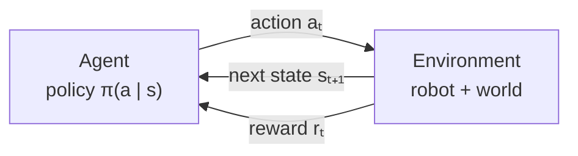
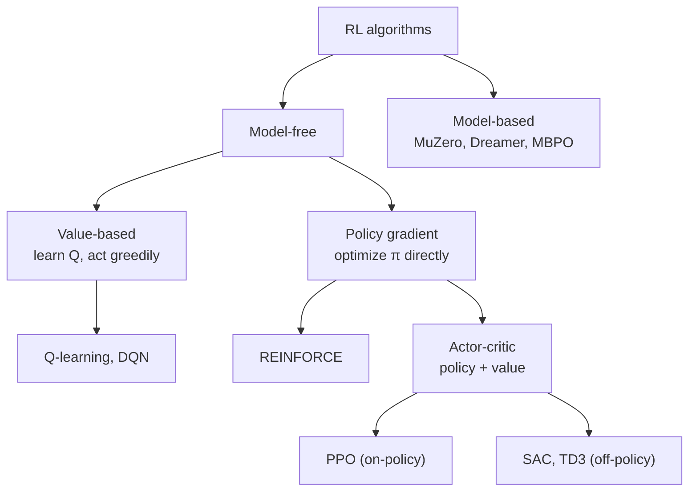
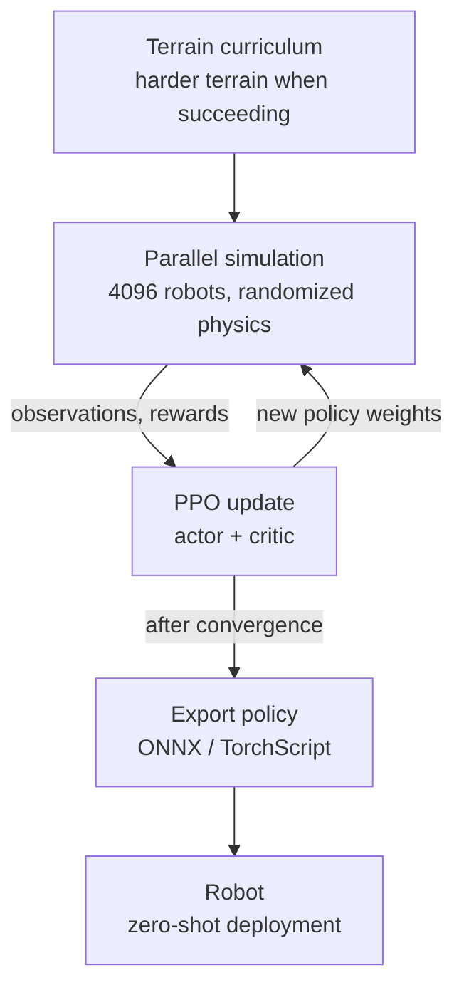
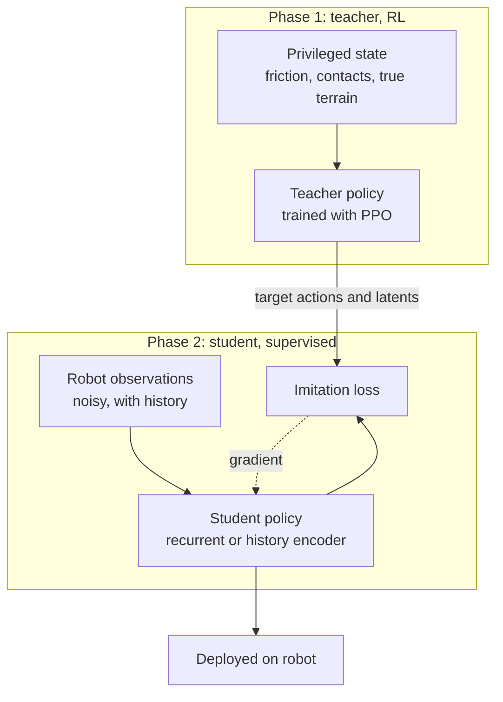

* TOC
{:toc}

## Overview

Supervised learning needs a label for every input: this image is a cat, this point is ground. For many robotics problems there is no such label. Nobody can write down the correct torque for each of a quadruped's 12 joints at every millisecond while it climbs stairs. What we can say is whether the outcome was good: the robot moved at the commanded speed, did not fall, and did not waste energy.

**Reinforcement learning (RL)** learns from exactly that kind of signal. An agent tries actions, observes what happens, receives a scalar **reward**, and gradually changes its behavior to collect more reward over time. No one tells it which action was correct; it has to find out by trial and error, and it has to figure out which of its many earlier actions deserve credit for a reward that arrives later.

This post covers:

1. The interaction loop and the formal model behind it (the Markov decision process).
2. The components every RL method is built from: policy, reward, return, value function, model.
3. The main algorithm families, with PPO in some detail, since it trains most robot controllers today.
4. How RL produces a locomotion controller for a legged robot: simulation, rewards, observations, domain randomization, teacher-student training, and deployment.

## The interaction loop

Everything in RL is built on one loop. At each time step $t$ the **agent** observes the **state** $s\_t$ of the **environment**, picks an **action** $a\_t$, and the environment responds with a new state $s\_{t+1}$ and a **reward** $r\_t$.



For a walking robot:

| Term | Example for a quadruped |
| --- | --- |
| Agent | The neural network controller |
| Environment | Robot body, actuators, terrain, gravity, contacts |
| State $s\_t$ | Base orientation and velocity, joint angles and speeds, terrain around the feet |
| Action $a\_t$ | 12 joint position targets |
| Reward $r\_t$ | + tracking the commanded velocity, - falling, - energy, - jerky motion |
| Episode | One run from a reset until a fall or a time limit, e.g. 20 s |

The loop repeats for an **episode**. Then the environment resets and a new episode starts. Training is millions of episodes.

### Markov decision process

The loop is formalized as a **Markov decision process (MDP)**, the tuple $(\mathcal{S}, \mathcal{A}, P, R, \gamma)$:

- $\mathcal{S}$, the set of states, and $\mathcal{A}$, the set of actions. Both can be continuous (joint angles, torques).
- $P(s' \mid s, a)$, the **transition dynamics**: the probability of landing in $s'$ after taking $a$ in $s$. For a robot, this is physics. The agent does not know it.
- $R(s, a)$, the **reward function**. This one we design.
- $\gamma \in [0, 1)$, the **discount factor**, which sets how much the future matters (more below).

**Markov** means the next state depends only on the current state and action, not on the history before it. That is a property of what you put into the state. Joint angles alone are not Markov for a walking robot, since they do not tell you how fast the joints are moving; add joint velocities and they are much closer. When the agent sees only part of the true state (a camera does not see the friction coefficient), the problem is a **partially observable MDP (POMDP)**, and the policy usually gets a history of observations or a recurrent memory to compensate. Every real robot is a POMDP.

## Components of an RL agent

### Policy

The **policy** $\pi$ is the agent's behavior: a mapping from state to action. It is the thing we are ultimately learning, and the thing that runs on the robot.

- **Deterministic**: $a = \pi(s)$.
- **Stochastic**: $a \sim \pi(a \mid s)$, a probability distribution over actions. For continuous control this is usually a Gaussian whose mean is a neural network output and whose standard deviation is a learned parameter. The randomness drives exploration during training; on the robot, you typically execute the mean.

In deep RL the policy is a neural network $\pi\_\theta$ with weights $\theta$. For locomotion it is often a small multilayer perceptron (three layers of 128 to 512 units), sometimes with a recurrent layer, which runs in well under a millisecond on a CPU.

### Reward

The **reward** $r\_t$ is a single number per step that says how good that step was. It is the only way to tell the agent what you want. The **reward hypothesis** says that any goal can be expressed as maximizing the expected sum of a scalar reward. In practice, writing that scalar so that it produces the behavior you actually want is the hardest part of applied RL.

Rewards are either **sparse** (+1 when the robot reaches the goal, 0 otherwise) or **dense** (a small reward every step for moving in the right direction). Sparse rewards are easy to specify but hard to learn from, because a random policy almost never sees a non-zero reward. Dense, shaped rewards learn quickly but invite **reward hacking**: the agent finds a way to score well that you did not intend, such as vibrating its legs to get a velocity reward without walking.

### Return and discount

The agent does not maximize the reward of the next step. It maximizes the **return**, the discounted sum of all future rewards:

$$
G_t = r_t + \gamma r_{t+1} + \gamma^2 r_{t+2} + \dots = \sum_{k=0}^{\infty} \gamma^k r_{t+k} \tag{1}
$$

The discount $\gamma$ in Eq. (1) does three things:

- Makes the infinite sum finite.
- Prefers rewards sooner rather than later.
- Sets an **effective horizon** of roughly $1 / (1 - \gamma)$ steps. With $\gamma = 0.99$, the agent effectively looks 100 steps ahead; at 50 Hz that is 2 seconds, about the right horizon for a walking gait. With $\gamma = 0.9$, it looks only 10 steps ahead.

### Value functions

A value function predicts the return. It is how the agent assigns credit to actions whose payoff comes later.

- The **state value** $V^\pi(s) = \mathbb{E}\_\pi[G\_t \mid s\_t = s]$: how much return to expect from state $s$ when following $\pi$.
- The **action value** $Q^\pi(s, a) = \mathbb{E}\_\pi[G\_t \mid s\_t = s, a\_t = a]$: the same, but taking action $a$ first and following $\pi$ afterwards.
- The **advantage** $A^\pi(s, a) = Q^\pi(s, a) - V^\pi(s)$: how much better action $a$ is than the policy's average behavior in $s$. Positive means "do this more often". Most modern policy-gradient methods are driven by the advantage.

Values satisfy a recursive relation, the **Bellman equation**, Eq. (2). The value of a state is the immediate reward plus the discounted value of where you land:

$$
V^\pi(s) = \mathbb{E}_{a \sim \pi,\ s' \sim P} \left[ r(s, a) + \gamma V^\pi(s') \right] \tag{2}
$$

For the optimal policy, the expectation over actions becomes a max:

$$
V^*(s) = \max_a \mathbb{E}_{s' \sim P} \left[ r(s, a) + \gamma V^*(s') \right] \tag{3}
$$

If the dynamics $P$ are known and the state space is small, you can apply Eq. (3) repeatedly to every state until the values stop changing. That is **value iteration**, and acting greedily with respect to $V^\*$ gives the optimal policy.

The figure solves a small grid world this way. The robot starts at S and wants to reach G. Entering G pays a reward of +10 and ends the episode. The bottom row in front of the goal is a cliff: entering it pays -10 and also ends the episode. Both are terminal states, so their value is 0: the +10 is the reward for the last step, and it shows up in the values of the cells next to G, not in G itself. Each step costs a small amount, and with some probability the robot slips sideways instead of moving where it intended, like a foot sliding on a wet surface.



Things to try:

- **Slip 0%**: the policy walks right along the cliff edge, the shortest path, because nothing can go wrong.
- **Slip 20%, step -0.1**: the policy moves one row further up. Two extra steps cost less than a 10% chance of falling.
- **Step -1.5**: the detour is now too expensive and the policy goes back to the edge.
- **$\gamma$ = 0.5**: the effective horizon is 2 steps. Values near the start become almost entirely step cost, and the goal is effectively invisible from there.

The same trade-offs show up on a real robot: the discount sets how far ahead it plans, and the balance between task reward and penalties sets how cautious it is.

### Model

A **model** is the agent's own prediction of the environment, $\hat{P}(s' \mid s, a)$ and $\hat{R}(s, a)$. **Model-based** RL learns or is given a model and plans with it (value iteration above is the extreme case: a perfect model). **Model-free** RL never builds a model; it learns values or a policy directly from experience. Most robot locomotion work is model-free inside a simulator, which is a model, just not one the agent can query for planning.

### Exploration and exploitation

To find good actions the agent must try actions it is unsure about (**exploration**). To collect reward it must use what it already knows (**exploitation**). Doing only one fails: pure exploitation gets stuck on the first strategy that works at all, pure exploration never uses what it learned. Common mechanisms:

- **$\epsilon$-greedy** (discrete actions): take a random action with probability $\epsilon$.
- **Gaussian action noise** (continuous actions): the stochastic policy's standard deviation. It is learned and usually shrinks as training converges.
- **Entropy bonus**: add the policy's entropy to the objective, which rewards keeping options open (SAC is built around this).

## Algorithm families



### Value-based: Q-learning and DQN

Learn $Q(s, a)$ and act with $a = \arg\max\_a Q(s, a)$. The update moves $Q$ toward the one-step **temporal difference (TD) target**:

$$
Q(s, a) \leftarrow Q(s, a) + \alpha \left[ r + \gamma \max_{a'} Q(s', a') - Q(s, a) \right] \tag{4}
$$

The bracket in Eq. (4) is the **TD error**: what actually happened (one real reward plus the estimated rest) minus what was predicted. **DQN** (2015) replaced the table with a neural network, plus a replay buffer and a slowly updated target network for stability, and learned to play Atari games from pixels. The weakness for robotics is the $\max\_a$: with 12 continuous joint targets there is no finite list of actions to take the max over.

### Policy gradient

Optimize the policy directly. Write the objective as the expected return $J(\theta) = \mathbb{E}\_{\pi\_\theta}[G\_0]$. The **policy gradient theorem** gives its gradient as

$$
\nabla_\theta J(\theta) = \mathbb{E}_{\pi_\theta} \left[ \sum_t \nabla_\theta \log \pi_\theta(a_t \mid s_t) \, A(s_t, a_t) \right] \tag{5}
$$

Read Eq. (5) as: for each action taken, increase its log-probability in proportion to how much better than average it turned out. Good actions become more likely, bad ones less likely. This works for continuous actions out of the box. **REINFORCE** uses the full sampled return in place of $A$, which is unbiased but very noisy.

### Actor-critic

Use two networks: an **actor** (the policy) and a **critic** (a value function $V\_\phi(s)$). The critic estimates the advantage $A$ in Eq. (5), which lowers the variance of the policy gradient a lot. The simplest estimate is the TD error, $A\_t \approx r\_t + \gamma V(s\_{t+1}) - V(s\_t)$. **Generalized Advantage Estimation (GAE)** blends TD errors over many steps with a parameter $\lambda$ that trades bias (small $\lambda$) against variance ($\lambda \to 1$).

Two main sub-families:

| | On-policy (PPO) | Off-policy (SAC, TD3) |
| --- | --- | --- |
| Data used for an update | Only fresh rollouts from the current policy | Any past data, from a replay buffer |
| Sample efficiency | Low | High |
| Stability, tuning effort | Robust, few sensitive hyperparameters | More sensitive |
| Scales with parallel simulation | Very well | Less naturally |
| Typical use | Locomotion in simulation | Real-robot learning, manipulation |

With thousands of parallel simulated robots, samples are cheap and stability matters more than sample efficiency. That is why PPO is the default for legged locomotion.

### PPO

The naive policy gradient has a failure mode: one large update step can wreck a good policy, and since the next batch of data comes from that wrecked policy, it may never recover. **Proximal Policy Optimization (PPO)** keeps each update close to the policy that collected the data.

Let $r\_t(\theta) = \pi\_\theta(a\_t \mid s\_t) / \pi\_{\theta\_\text{old}}(a\_t \mid s\_t)$ be the ratio of new to old action probability. PPO maximizes the **clipped surrogate objective**

$$
L^\text{CLIP}(\theta) = \mathbb{E}_t \left[ \min\left( r_t(\theta) A_t,\ \text{clip}(r_t(\theta), 1 - \epsilon, 1 + \epsilon) A_t \right) \right] \tag{6}
$$

with $\epsilon$ typically 0.2. Read it term by term.

**The ratio.** $r\_t(\theta)$ measures how much the update has changed the probability of the action that was actually taken. $r\_t = 1$ means unchanged (at the start of each update, $\theta = \theta\_\text{old}$), $r\_t = 1.5$ means 50% more likely, $r\_t = 0.5$ means half as likely. The first term inside the min, $r\_t(\theta) A\_t$, is the plain policy gradient objective written with this ratio: its gradient at $r\_t = 1$ equals Eq. (5). On its own it has no limit. For a good action ($A\_t > 0$) it keeps rewarding a larger $r\_t$, so a few gradient steps on the same batch can push the probability far beyond what the data supports.

**The clip.** $\text{clip}(x, l, u)$ limits a number to the interval $[l, u]$:

$$
\text{clip}(r, 1 - \epsilon, 1 + \epsilon) =
\begin{cases}
1 - \epsilon & r < 1 - \epsilon \\
r & 1 - \epsilon \le r \le 1 + \epsilon \\
1 + \epsilon & r > 1 + \epsilon
\end{cases}
\tag{7}
$$

With $\epsilon = 0.2$ the ratio is confined to $[0.8, 1.2]$. Outside that interval the clipped term is a constant, so its gradient with respect to $\theta$ is zero: the sample stops asking for more change. If an action had probability 0.5 under the old policy and turned out better than expected, the update gains nothing from pushing it beyond 0.6.

**The min.** Clipping alone would also flatten the cases where the update went the wrong way, and the policy would never correct them. Taking the min of the clipped and unclipped terms picks whichever is smaller, a pessimistic lower bound on the improvement. The result is that the clip removes only the incentive to move further in the helpful direction, never the penalty for moving in the harmful one:

| Advantage | Ratio | Term chosen by the min | Gradient on the action probability |
| --- | --- | --- | --- |
| $A\_t > 0$ (good action) | $r\_t < 1 - \epsilon$ | unclipped $r\_t A\_t$ | Up: undo a decrease that went the wrong way |
| $A\_t > 0$ | inside $[1 - \epsilon, 1 + \epsilon]$ | both equal | Up |
| $A\_t > 0$ | $r\_t > 1 + \epsilon$ | clipped $(1 + \epsilon) A\_t$ | Zero: already increased enough |
| $A\_t < 0$ (bad action) | $r\_t < 1 - \epsilon$ | clipped $(1 - \epsilon) A\_t$ | Zero: already decreased enough |
| $A\_t < 0$ | inside $[1 - \epsilon, 1 + \epsilon]$ | both equal | Down |
| $A\_t < 0$ | $r\_t > 1 + \epsilon$ | unclipped $r\_t A\_t$ | Down: undo an increase that went the wrong way |

The figure plots these six cases.



The flat regions of Eq. (6) are the point: once an action's probability has moved by more than $\epsilon$ in the helpful direction, that sample stops pushing. This allows several epochs of minibatch gradient steps on the same batch of data without the policy running away. The clip is a soft limit, not a hard constraint: other samples can still move the policy, and parameters are shared across states, so implementations also monitor the KL divergence between the old and new policy and stop early or lower the learning rate when it grows too large.

One PPO iteration:

```python
for iteration in range(num_iterations):
    # 1. Rollout: run the current policy in N parallel environments for T steps.
    batch = collect_rollouts(policy, envs, num_steps=T)  # obs, actions, rewards, dones, log_probs

    # 2. Advantages with GAE, using the critic's value estimates.
    values = critic(batch.obs)
    advantages, returns = gae(batch.rewards, values, batch.dones, gamma=0.99, lam=0.95)

    # 3. Several epochs of minibatch updates on the same data.
    for epoch in range(5):
        for mb in batch.minibatches(4):
            ratio = exp(policy.log_prob(mb.obs, mb.actions) - mb.log_probs)
            surrogate = min(ratio * mb.adv, clip(ratio, 1 - 0.2, 1 + 0.2) * mb.adv)
            policy_loss = -mean(surrogate) - entropy_coef * policy.entropy(mb.obs).mean()
            value_loss = mean((critic(mb.obs) - mb.returns) ** 2)
            optimize(policy_loss + value_coef * value_loss)
```

With a GPU simulator, $N$ is 4096 robots and $T$ is 24 steps, so each iteration collects about 100,000 transitions in well under a second of wall time.

## RL for robot controllers

### Why learn a controller

The classical approach to legged locomotion is model-based: a simplified dynamics model, a contact schedule, and model predictive control (MPC) that optimizes forces over a short horizon. It works well and is interpretable. It struggles where the model is wrong: slippery or deformable ground, unexpected contacts, missed steps, terrain that does not match the map.

RL moves the hard work offline. Instead of solving an optimization on the robot at every step, it trains a policy against millions of situations in simulation, including the ones that break the model. On the robot, the policy is one forward pass of a small network.

| | Model-based (MPC, WBC) | Learned policy (RL) |
| --- | --- | --- |
| Online cost | Optimization every step | One network forward pass |
| Needs | Accurate model, contact schedule, tuning | Simulator, reward design, compute |
| Robustness to unmodeled effects | Limited by the model | Learned from randomized simulation |
| Interpretability, guarantees | Good: constraints are explicit | Weak: behavior is implicit in weights |
| Changing the behavior | Edit costs or constraints | Retrain |

The two are not exclusive. Common hybrids use RL to produce references for a model-based controller, or a model-based controller as a safety filter around a learned policy.

### The controller on the robot

{% include figures/rl-control-loop.html caption="A learned locomotion controller as deployed. Only the policy network is learned. It does not output torques directly but joint position targets $q^\*$, which a fast PD loop in the drives tracks. State estimation and the elevation map are the classical perception stack; they turn sensor data into the observation the policy was trained on. The command is not a separate input: it is concatenated into the same observation vector, so the policy learns to read it like any other measurement." %}

Design choices that matter:

- **Action space.** Policies usually output joint position targets around a nominal standing pose, tracked by a PD controller with fixed gains. This is easier to learn than raw torques: the PD loop provides stiffness and a stable default, and the network only has to shape it. Running the policy at about 50 Hz and the PD at the drive's rate separates fast tracking from slower decision-making.
- **Observation space.** Proprioception (base angular and linear velocity, gravity vector in the base frame, joint positions and velocities, the previous action) plus the command. For perceptive locomotion, add terrain heights sampled around each foot from the elevation map. Use only what you can provide with the same quality on the real robot.
- **History.** A window of past observations or a recurrent layer lets the policy infer what it cannot see directly, such as ground friction, a payload, or a slipping foot, from how the body has been responding.

### Training in simulation

Real-robot training is slow and breaks hardware. Locomotion policies are trained entirely in simulation (Isaac Gym/Isaac Lab, MuJoCo, RaiSim) and deployed zero-shot. GPU simulators step thousands of robots in parallel, which brings training of a basic flat-ground walking policy down to minutes and rough-terrain policies to hours.



### Reward design for locomotion

A locomotion reward is a weighted sum of many terms: a few that define the task and many that regularize the motion. Without the regularizers, the policy usually finds an odd gait that works in simulation and breaks hardware.

| Term | Form | Purpose |
| --- | --- | --- |
| Linear velocity tracking | $\exp(-\lVert \mathbf{v}\_{xy}^\text{cmd} - \mathbf{v}\_{xy} \rVert^2 / \sigma)$ | The task: move at the commanded speed |
| Yaw rate tracking | $\exp(-(\omega\_z^\text{cmd} - \omega\_z)^2 / \sigma)$ | The task: turn at the commanded rate |
| Vertical velocity, roll and pitch rate | $-v\_z^2$, $-\lVert \boldsymbol{\omega}\_{xy} \rVert^2$ | Keep the body steady |
| Joint torques | $-\lVert \boldsymbol{\tau} \rVert^2$ | Energy, actuator heating |
| Joint accelerations | $-\lVert \ddot{\mathbf{q}} \rVert^2$ | Smooth motion |
| Action rate | $-\lVert \mathbf{a}\_t - \mathbf{a}\_{t-1} \rVert^2$ | No jitter, which real actuators cannot follow |
| Feet air time | positive for steps of a reasonable length | Proper stepping instead of shuffling |
| Undesired contacts | $-1$ per knee or base contact | Walk on feet only |
| Termination | large negative on fall | Do not fall |

The tracking terms use $\exp(-\text{error}^2)$ rather than $-\text{error}^2$ so that they are bounded and positive, which keeps the reward from being dominated by large errors early in training. Tuning the weights is iterative: train, watch the gait, find what looks wrong, add or reweight a term.

### Closing the sim-to-real gap

A policy that walks in simulation can fail on the robot, because simulation differs from reality in ways the policy learned to rely on. The main tools:

- **Domain randomization.** Randomize what you are unsure about during training: ground friction, base mass and center of mass, payloads, motor strength, PD gains, sensor noise, observation latency, and random pushes to the body. The policy cannot overfit to one simulator setting, so it learns a strategy that works across the whole range, and reality is hopefully one more sample from that range.
- **Actuator modeling.** The drives are often the largest gap. Series-elastic actuators have dynamics a rigid simulator does not capture. One solution is an **actuator network**: a small network trained on real drive data that maps commanded targets and recent joint state to the torque the drive actually produces, used inside the simulator in place of an ideal motor.
- **Terrain curriculum.** Start on flat ground. A robot that walks far enough in its episode gets promoted to rougher terrain, steeper slopes and higher stairs; one that fails gets demoted. Each robot keeps training at the edge of its ability.
- **Realistic observations.** Add the noise, delays and failure modes of the real sensors. For perceptive policies, corrupt the height map with offsets, missing patches and drift, so the policy learns when not to trust it.

### Teacher-student training

In simulation we know everything: exact friction, contact states, the terrain without noise. On the robot we know much less. **Teacher-student** training (also called privileged learning, or asymmetric actor-critic when only the critic gets the extra data) uses this:



1. Train a **teacher** with RL using privileged information. With perfect knowledge, learning is fast and the resulting gait is good.
2. Train a **student** that sees only what the real robot sees, including a history of observations, to reproduce the teacher's actions (and often its internal latent representation of the environment). This is supervised learning, which is much easier than RL from noisy observations.
3. Deploy the student. Its memory has learned to infer friction, slippage and terrain properties from the recent motion, because that was necessary to imitate the teacher.

This recipe produced some of the best-known results on ANYmal: blind locomotion over rough natural terrain, and perceptive locomotion that combines the elevation map with proprioception and falls back on proprioception when the map is wrong, for example in tall grass or snow.

### Beyond locomotion

The same pipeline, with different rewards and observations, is used for:

- **Navigation and local planning**: a policy that outputs velocity commands from a local map, trained to reach a goal without collisions, sitting on top of a locomotion policy.
- **Parkour and agile skills**: jumps, climbing onto boxes, recovering from falls.
- **Manipulation**: in-hand object reorientation, legged mobile manipulation with an arm.
- **Whole-body control for humanoids**, often initialized from human motion capture through an imitation reward.

### Practical pitfalls

- **Reward hacking.** The policy optimizes the reward you wrote, not the one you meant. Watch videos of the policy, not just the reward curve.
- **Simulation exploits.** Penetrating the ground slightly, using unrealistic contact forces, or vibrating at a frequency the simulator integrates incorrectly. Physics errors become free energy.
- **Observation mismatch.** A frame convention, unit or ordering that differs between simulation and the robot (joint order, a gravity vector in the wrong frame, degrees versus radians) gives a policy that fails instantly. Log observations on the robot and replay them through the policy in simulation.
- **Seed sensitivity.** Training runs with different random seeds can produce visibly different gaits. Compare several seeds before drawing conclusions about a change.
- **Safety and verification.** A neural network policy has no explicit constraints. Deploy with a fallback controller, hardware limits on torque and joint range, and staged testing: simulation, robot on a gantry or harness, then free.

## Summary

- RL learns behavior from a scalar reward instead of labeled examples, by trial and error in a loop of state, action, reward.
- The pieces: an MDP describing the problem, a policy to learn, a reward you design, a return discounted by $\gamma$, value functions that predict that return, and optionally a model.
- Value-based methods (DQN) suit discrete actions. Policy gradient and actor-critic methods suit continuous control, and PPO, with its clipped update, is the robust default when simulation is cheap.
- A learned robot controller is a small network running at around 50 Hz that outputs joint position targets for a fast PD loop, trained in massively parallel simulation with a multi-term reward, domain randomization, a terrain curriculum and teacher-student distillation.
- The hard parts are not the RL algorithm: they are the reward, the simulation fidelity, and making sure the robot sees what the policy saw during training.

## References

- R. Sutton, A. Barto, [*Reinforcement Learning: An Introduction*](http://incompleteideas.net/book/the-book-2nd.html), 2nd edition, MIT Press, 2018. The standard textbook, free online.
- V. Mnih et al., ["Human-level control through deep reinforcement learning"](https://doi.org/10.1038/nature14236), *Nature*, 2015. DQN.
- J. Schulman et al., ["High-Dimensional Continuous Control Using Generalized Advantage Estimation"](https://arxiv.org/abs/1506.02438), ICLR, 2016.
- J. Schulman et al., ["Proximal Policy Optimization Algorithms"](https://arxiv.org/abs/1707.06347), arXiv:1707.06347, 2017.
- T. Haarnoja et al., ["Soft Actor-Critic: Off-Policy Maximum Entropy Deep Reinforcement Learning with a Stochastic Actor"](https://arxiv.org/abs/1801.01290), ICML, 2018.
- J. Hwangbo et al., ["Learning agile and dynamic motor skills for legged robots"](https://doi.org/10.1126/scirobotics.aau5872), *Science Robotics*, 2019. Actuator network, sim-to-real on ANYmal.
- J. Lee et al., ["Learning quadrupedal locomotion over challenging terrain"](https://doi.org/10.1126/scirobotics.abc5986), *Science Robotics*, 2020. Teacher-student training.
- N. Rudin et al., ["Learning to Walk in Minutes Using Massively Parallel Deep Reinforcement Learning"](https://arxiv.org/abs/2109.11978), CoRL, 2021. GPU simulation, terrain curriculum.
- T. Miki et al., ["Learning robust perceptive locomotion for quadrupedal robots in the wild"](https://doi.org/10.1126/scirobotics.abk2822), *Science Robotics*, 2022.
- [OpenAI Spinning Up in Deep RL](https://spinningup.openai.com/), a practical introduction with clean reference implementations.
