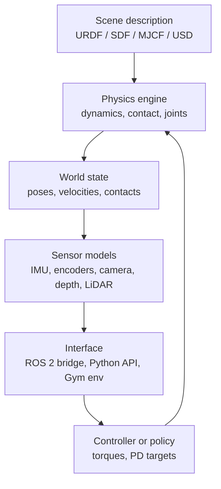
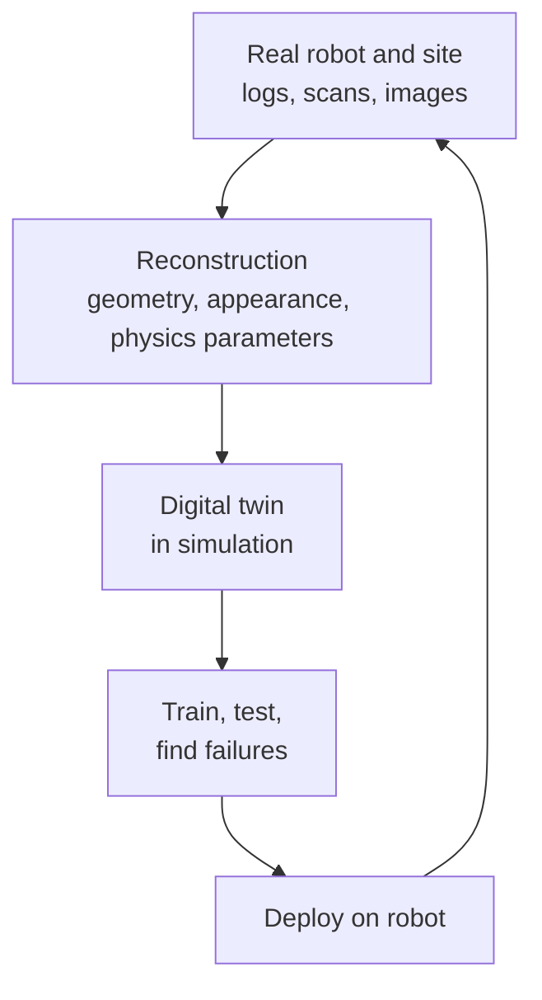
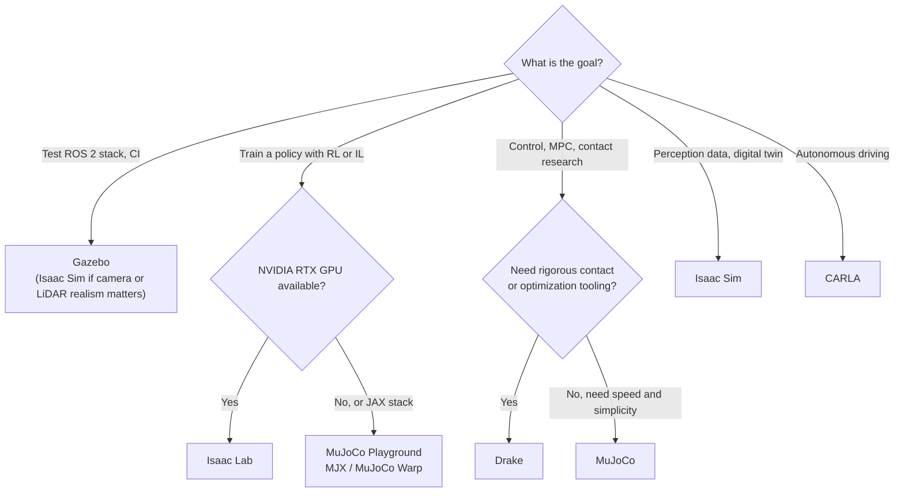

* TOC
{:toc}

## Overview

A robotics simulator answers one question: given the robot's state, its commands and its environment, what happens next, and what would the sensors report? Everything else, the GUI, the ROS bridge, the RL wrappers, is built around that loop.

Simulation is used for four different jobs, and they want different tools:

1. **Integration testing**: run the real software stack (drivers, state estimation, navigation, mission logic) against a virtual robot, often in CI.
2. **Learning controllers**: generate the billions of samples that reinforcement learning needs, which is only practical when thousands of environments run in parallel on a GPU.
3. **Perception and synthetic data**: render camera, depth and LiDAR data with ground-truth labels for training and evaluating perception models.
4. **Control and planning research**: get accurate, differentiable or at least well-behaved dynamics and contacts for MPC, trajectory optimization and system analysis.

No simulator is best at all four. This post explains what is inside a simulator, walks through the main ones (Gazebo, MuJoCo, Isaac Sim, Isaac Lab and others), covers the sim-to-real gap and how to close it, and then the reverse direction, real-to-sim. It ends with a decision guide.

## What is inside a simulator

### Scene description

Robots and worlds are loaded from description files:

| Format | Origin | Used by | Notes |
| --- | --- | --- | --- |
| URDF | ROS | almost everything, as import | Tree of links and joints only, no closed loops, no world description |
| SDF | Gazebo | Gazebo | Robots and worlds, sensors, plugins, nested models |
| MJCF | MuJoCo | MuJoCo, MJX, Brax | Compact XML, defaults classes, tendons, actuators with explicit gains |
| USD | Pixar, NVIDIA Omniverse | Isaac Sim, Isaac Lab | Layered scene graph, scales to large photoreal scenes, physics via schemas |

In practice URDF is the interchange format: the robot description lives in the ROS repository, and each simulator imports it into its native format. Every importer makes choices (default joint damping, collision mesh convexification, inertia handling), so check the imported model instead of trusting it.

### Physics engine

Articulated rigid-body dynamics in generalized coordinates $q$:

$$
M(q)\,\ddot{q} + C(q, \dot{q})\,\dot{q} + g(q) = \tau + J_c(q)^\top \lambda
$$

$M$ is the mass matrix, $C$ the Coriolis and centrifugal terms, $g$ gravity, $\tau$ the joint torques and $J\_c^\top \lambda$ the contact forces mapped into joint space. The equation is the easy part. The hard parts are:

- **Contact**: $\lambda$ must satisfy non-penetration and Coulomb friction ($\lVert \lambda\_t \rVert \le \mu \lambda\_n$). Solving that exactly is a complementarity problem, which is non-smooth and expensive. Engines approximate it differently: PhysX and ODE use iterative impulse solvers on a hard-contact model, MuJoCo uses a soft, convex formulation that allows a small, tunable penetration in exchange for a unique solution, and Drake offers hydroelastic contact that models a pressure field over the contact patch.
- **Integration**: robots with stiff PD gains and light links need small time steps (typically 1 to 5 ms) or implicit integration to stay stable.
- **Articulations**: reduced-coordinate (Featherstone) solvers keep joints exact; maximal-coordinate solvers enforce joints as constraints and can drift under load.

These choices are the main reason the same robot behaves differently in two simulators. A policy that exploits a quirk of one contact model, for example sliding feet that never slip, fails in another one and on hardware.

### Sensor models

Proprioceptive sensors (joint encoders, IMU, force/torque) come almost for free from the state. Exteroceptive sensors are rendering problems: a camera needs a rasterizer or ray tracer, a LiDAR needs ray casting against the scene geometry, and a depth camera needs both plus a model of its failure modes. Sensor fidelity varies far more between simulators than physics fidelity does.

### CPU versus GPU simulation

Classic simulators step one world on the CPU, roughly in real time. GPU simulators step thousands of copies of the same world in parallel, with the state of all environments kept in GPU tensors so the policy network reads observations without copying them back. For RL this is the difference between days and minutes: Rudin et al. trained ANYmal to walk on rough terrain in about 20 minutes on a single GPU with 4096 parallel environments [3]. The price is flexibility: GPU pipelines prefer identical robots, simple sensors and batched Python APIs, not a ROS stack running per environment.

## The simulators

### Gazebo

Gazebo is the default simulator of the ROS ecosystem, maintained by Open Robotics (now part of Intrinsic).

- **Two generations.** Gazebo Classic (up to version 11) reached end of life in January 2025. The new Gazebo (formerly Ignition) is a set of libraries, `gz-sim`, `gz-physics`, `gz-sensors`, `gz-rendering`, released as named distributions such as Fortress, Harmonic and Jetty. Each ROS 2 distribution has a recommended pairing, for example Jazzy with Harmonic.
- **Physics.** Pluggable through `gz-physics`; DART is the default, Bullet and a trivial physics engine (TPE) are alternatives.
- **Sensors.** Cameras, depth, GPU LiDAR, IMU, contact, force/torque, GPS, rendered with Ogre 2.
- **ROS integration.** `ros_gz` bridges topics, and `gz_ros2_control` lets the same `ros2_control` controllers run in simulation and on hardware.

**Strengths**: runs the real ROS 2 stack unmodified, headless mode for CI, a large catalog of community models and worlds, lightweight enough for a laptop.

**Weaknesses**: one world per process and roughly real-time speed, so it is not a training engine. Contact dynamics for legged robots and manipulation are adequate for software testing, not for transferring learned policies. Rendering is functional rather than photorealistic.

**Use it for** testing navigation, mapping, mission logic and launch files end to end, and for regression tests in CI.

### MuJoCo

MuJoCo (Multi-Joint dynamics with Contact) was written by Emo Todorov for model-based control research, acquired by DeepMind in 2021 and open-sourced under Apache 2.0 in 2022 [1].

- **Physics.** Generalized coordinates with a convex, soft contact model. Simulation is deterministic, stable at relatively large time steps and fast on a single CPU core. Tendons, muscles, equality constraints and actuators with explicit dynamics are first-class.
- **Model format.** MJCF, with URDF import. The model is compiled into a flat, cache-friendly data structure.
- **Analytic access.** Forward and inverse dynamics, Jacobians, finite-difference derivatives, which is why MPC and trajectory optimization researchers like it.
- **GPU variants.** MJX reimplements MuJoCo in JAX for batched simulation on GPU and TPU. MuJoCo Warp, developed with NVIDIA, targets NVIDIA GPUs, and MuJoCo Playground packages ready-made locomotion and manipulation environments on top of them.
- **Rendering.** A simple OpenGL renderer, good enough for debugging and low-fidelity vision, not for photorealism.

**Strengths**: accurate and well-documented contact model, easy installation (`pip install mujoco`), runs anywhere including macOS, a large set of curated robot models in MuJoCo Menagerie.

**Weaknesses**: no ROS integration out of the box, limited sensor rendering, soft contacts need tuning (`solref`, `solimp`) to avoid visible penetration or overly springy feet.

**Use it for** control research, MPC, contact-rich manipulation studies, quick RL prototypes, and as an independent second simulator for validating policies trained elsewhere.

### NVIDIA Isaac Sim

Isaac Sim is NVIDIA's robotics simulator built on Omniverse. It is open source on GitHub since version 5.0.

- **Scene.** Everything is USD. Large environments, warehouses or industrial plants, can be built from CAD and assets and edited collaboratively.
- **Physics.** PhysX 5 on CPU or GPU: articulations, rigid and soft bodies, particles for fluids and cloth.
- **Rendering and sensors.** RTX ray tracing for photorealistic cameras, and ray-traced LiDAR and radar models that can be configured to match specific sensor products, including scan patterns and material-dependent returns.
- **Synthetic data.** Replicator randomizes lighting, materials, poses and distractors, and writes images with ground-truth labels: bounding boxes, segmentation, depth, normals.
- **Integration.** ROS 2 bridge, Python scripting, importers for URDF, MJCF and CAD.

**Strengths**: the highest sensor fidelity among general-purpose robotics simulators, industrial-scale scenes, synthetic data generation and digital twins in one tool.

**Weaknesses**: needs an NVIDIA RTX GPU with plenty of VRAM, a heavy install and long startup times, Linux and Windows only, a steep learning curve (USD, Kit extensions, Omniverse concepts). For a pure ROS software test it is far more machinery than needed.

**Use it for** perception development, synthetic datasets, sensor placement studies, digital twins of customer sites, and ROS 2 testing where camera or LiDAR realism matters.

### NVIDIA Isaac Lab

Isaac Lab is an open-source robot learning framework on top of Isaac Sim. It merges ETH Zurich's Orbit [2] and NVIDIA's earlier Isaac Gym, which is now deprecated.

- **Massively parallel.** Thousands of environments on one GPU with GPU-resident state, plus tiled rendering so that camera-based policies can also be trained in parallel.
- **Two workflows.** Manager-based environments compose observations, rewards, terminations, events (randomization) and curricula from reusable terms; direct environments implement everything in a single class for maximum speed and control.
- **Batteries included.** Environments for legged locomotion, humanoids, dexterous hands and arms; actuator models (ideal PD, DC motor, learned actuator networks); terrain generators with curricula; integrations with RL libraries such as RSL-RL, rl_games and skrl; imitation learning tools.
- **Physics backend.** PhysX through Isaac Sim today; Newton, an open-source GPU physics engine on NVIDIA Warp developed by NVIDIA, Google DeepMind and Disney Research, is being integrated as an alternative backend.

**Strengths**: the most complete stack for training locomotion and manipulation policies at scale, with domain randomization and sim-to-real features designed in from the start.

**Weaknesses**: inherits Isaac Sim's hardware and installation requirements; the abstraction layers take time to learn; API changes between major versions.

**Use it for** reinforcement learning and imitation learning of locomotion and manipulation policies that will run on hardware.

Isaac Sim and Isaac Lab are often confused. Isaac Sim is the simulator and application; Isaac Lab is a Python framework that uses Isaac Sim as its engine and adds everything needed for learning. If you are training policies, start in Isaac Lab. If you are building scenes, sensors, digital twins or ROS tests, work in Isaac Sim.

### Others worth knowing

| Simulator | What it is | Typical use |
| --- | --- | --- |
| Drake | Toyota Research Institute's toolbox: multibody dynamics, hydroelastic contact, optimization, systems framework | Rigorous manipulation research, trajectory optimization, verification |
| PyBullet | Python bindings to Bullet, the RL workhorse of 2017 to 2020 | Legacy code, teaching; largely superseded by MuJoCo |
| Webots | Open-source desktop simulator with many robot models | Education, quick prototypes |
| CoppeliaSim | Scriptable simulator with several physics engines | Education, industrial cell prototyping |
| Genesis | Python-native GPU simulator combining several solvers (rigid, MPM, SPH, FEM) | Research on multi-physics learning; check headline speed claims against your own workloads |
| RaiSim | Fast rigid-body engine from ETH's legged robotics group | Early ANYmal RL work [4] |
| ManiSkill / SAPIEN | GPU-parallel manipulation benchmark and simulator | Manipulation learning benchmarks |
| CARLA | Unreal Engine based driving simulator with traffic and sensors | Autonomous driving |

## Comparison

| | Gazebo | MuJoCo | Isaac Sim | Isaac Lab |
| --- | --- | --- | --- | --- |
| Primary job | ROS software testing | Control research, fast physics | Sensors, synthetic data, digital twins | Robot learning at scale |
| Physics | DART / Bullet | MuJoCo (soft convex contact) | PhysX 5 | PhysX 5 (Newton coming) |
| Parallel envs | 1 per process | 1 per thread on CPU; thousands with MJX / MuJoCo Warp | Few to hundreds | Thousands on one GPU |
| Sensor realism | Medium | Low | High (RTX) | High, but costly at scale |
| ROS 2 | Native (`ros_gz`) | Community bridges | Built-in bridge | Not the focus |
| Scene format | SDF | MJCF | USD | USD |
| Hardware | Any laptop | Any laptop | NVIDIA RTX GPU | NVIDIA RTX GPU |
| License | Apache 2.0 | Apache 2.0 | Apache 2.0 (Omniverse parts have own terms) | BSD-3 |

## The sim-to-real gap

A controller that works in simulation and fails on hardware has hit the **reality gap**: the difference between the simulated transition $p\_{\text{sim}}(s' \mid s, a)$ and the real one $p\_{\text{real}}(s' \mid s, a)$, plus the difference between simulated and real observations. Learned policies are especially exposed because optimization finds and exploits every modeling error that helps the reward.

### Where the gap comes from

**Dynamics**

- Mass, inertia and center of mass from CAD differ from the built robot (cables, batteries, payloads).
- Friction coefficients and restitution are guesses, and real friction depends on surface, wear, temperature and moisture.
- Contact models are approximations; soft-contact parameters and solver iterations change foot slip and impact behavior.

**Actuation**

- Real motors have torque-speed limits, current limits, gear backlash, joint friction and thermal derating.
- The low-level PD loop on the drive runs at kHz with its own bandwidth; an ideal torque source in simulation is not that.
- Series elastic actuators, like ANYmal's, add dynamics that a rigid joint model does not have.

**Latency and timing**

- Sensor-to-actuation delay of a few milliseconds to tens of milliseconds, jitter in the control loop, communication dropouts. A policy trained with zero delay often oscillates on hardware.

**Sensing**

- IMU bias and noise, encoder quantization, state estimator drift: the policy sees the estimator's output, not the simulator's ground truth.
- Cameras: exposure, motion blur, lens distortion, rolling shutter, color response.
- Depth and LiDAR: missing returns on dark or specular surfaces, mixed pixels at edges, reflections, rain, dust.

**Environment**

- Terrain not in the training distribution: deformable ground, vegetation, stairs with different dimensions, slippery spots.
- Unmodeled objects, people, lighting conditions.

### Closing the gap from the simulation side

**System identification.** Measure what you can and fit what you cannot: weigh links, estimate inertias from excitation trajectories, fit friction and motor parameters from logged data. This moves the simulator's nominal parameters toward reality.

**Actuator modeling.** When the actuator is the dominant error, learn it. Hwangbo et al. trained an *actuator network* that maps the history of position errors and velocities to output torque, using data logged on ANYmal, and used it inside the simulator; it was a key enabler of the first RL locomotion policies on that robot [4]. Isaac Lab ships actuator models of this kind.

**Domain randomization.** Instead of trying to get every parameter right, sample parameters from a range at each episode, so the policy has to work for all of them and the real robot becomes one more sample [5, 6]. Typical randomized quantities: friction, restitution, link masses and center of mass, motor strength, PD gains, latency, observation noise, external pushes, terrain, and for vision, textures, lighting and camera pose. Automatic domain randomization grows the ranges as the policy masters them [7].



Randomization is not free. Too wide a range makes the task harder to learn and produces a conservative policy that is mediocre everywhere. Randomize what you cannot identify, and identify what you can.

**Noise, delay and estimator modeling.** Add sensor noise, bias and dropouts to observations; delay actions and observations by a random number of steps; and, where possible, feed the policy the same estimated state it will see on hardware rather than ground truth.

**Privileged teacher, student policy.** Train a teacher policy with access to privileged information that exists only in simulation (true friction, terrain heights, contact states), then train a student that sees only real sensor history to imitate it. The student learns to infer the hidden quantities implicitly. Lee et al. used this to make ANYmal walk over challenging natural terrain [8], and Miki et al. extended it with perception and a learned belief state over noisy elevation maps [9].

**Online adaptation.** Policies such as RMA estimate an extrinsics vector from recent state-action history and adapt at run time without retraining [10].

**Regularize toward realistic behavior.** Penalize joint torques, action rate, foot slip and high contact forces. These rewards keep the policy away from regions where the simulator is least accurate, such as violent impacts.

**Validate across simulators.** Before hardware, run the trained policy in a second simulator with a different contact model, for example train in Isaac Lab and evaluate in MuJoCo. A policy that survives *sim-to-sim* transfer has not overfit one engine's quirks. It is the cheapest test in the pipeline.

**Fine-tune on hardware.** With safe exploration and enough automation, a small amount of real-world data can correct residual errors, either by updating the policy or by learning a residual dynamics model.

### Perception has its own gap

For learned perception, the gap is mostly appearance and sensor artifacts. The tools are photoreal rendering (Isaac Sim RTX), randomization of textures, lighting and clutter, sensor-specific noise models, and mixing synthetic data with a smaller set of labeled real data. A useful sanity check: train on synthetic only and evaluate on real; the drop tells you how much the synthetic data is worth.

Depth and elevation-map-based policies are easier to transfer than RGB-based ones, because geometry is easier to simulate than appearance. That is one reason many deployed legged locomotion policies use height maps rather than images.

## Real-to-sim

Sim-to-real asks how to make a simulated result hold in the real world. Real-to-sim asks the reverse: how to build the simulation *from* the real world, so that the robot is trained or tested in the environment it will actually meet.

### Robot: identify the dynamics

System identification is real-to-sim for the robot itself: collect excitation trajectories, then fit inertial parameters, friction and actuator models so that simulated trajectories match the recorded ones. Differentiable simulators (MJX, Warp-based engines, Drake) make this an optimization problem over physical parameters with gradients, instead of a manual tuning loop.

### Environment: reconstruct the scene

- **Meshes from scans.** LiDAR SLAM maps, terrestrial laser scans or photogrammetry give geometry that can be meshed and imported as collision and visual geometry. Good enough for navigation testing on an actual site layout.
- **CAD and BIM.** Industrial sites often have CAD or BIM models that convert to USD, giving a clean, semantically labeled twin, with the caveat that as-built rarely matches as-designed.
- **Neural reconstruction.** NeRF and 3D Gaussian Splatting ([previous post](/2026/09/21/nerf-and-gaussian-splatting/)) reconstruct a site's appearance photorealistically from images. Isaac Sim can now render Gaussian reconstructions next to USD assets. Splats have no collision geometry, so a mesh or depth-derived proxy is still needed for physics.
- **Articulated objects.** For manipulation, doors, drawers and valves need joints and limits, estimated from a few interactions or videos, not just a static mesh.
- **Physical properties.** Friction, mass and stiffness of objects and terrain are hard to see in images; they are estimated from interaction or set by randomization around a plausible value.

### Uses of real-to-sim

**Targeted training.** RialTo builds a simulated twin of a specific real scene from a phone scan, fine-tunes a policy there with RL, and transfers it back, improving robustness over imitation alone [11]. The general pattern, real-to-sim-to-real, trades generality for performance on the scenes that matter.

**Policy evaluation.** Real-world evaluation of robot policies is slow and noisy. SimplerEnv showed that simulated twins of real evaluation setups, with visual matching, can rank manipulation policies consistently with real-world results [12], making simulation useful as a cheap evaluation proxy.

**Log replay and failure reproduction.** A field failure is recorded in a rosbag. Open-loop replay feeds the recorded sensor data back into the software stack to reproduce perception or planning bugs. Closed-loop resimulation goes further: it reconstructs the scene from the recording and lets the robot act differently than it did, so that a fix can be tested in the same place where the failure happened. Neural reconstruction is what makes closed-loop resimulation of camera data feasible, since the rendered views change when the robot deviates from the recorded trajectory.

**Site-specific validation.** Before deploying a robot at a new facility, a twin built from the site's scan or CAD model lets you check localization, path coverage, docking positions and sensor visibility.

## Which simulator to use

| Situation | Choice | Why |
| --- | --- | --- |
| Navigation stack regression tests in CI | Gazebo, headless | Runs the real ROS 2 nodes, cheap, no GPU needed |
| Locomotion policy for a quadruped or humanoid | Isaac Lab, validate in MuJoCo | Massive parallelism, actuator models, terrain curricula; second engine catches simulator overfitting |
| MPC or whole-body controller development | MuJoCo, or Drake | Fast, accurate dynamics, analytic derivatives |
| Synthetic training data for a detector | Isaac Sim with Replicator | Photoreal rendering and automatic labels |
| LiDAR placement study for a new robot | Isaac Sim | Configurable ray-traced LiDAR models with real scan patterns |
| Reproducing a field failure at a customer site | Isaac Sim twin from scan or splats, or log replay | Real geometry and appearance |
| Teaching, quick experiments on a laptop | MuJoCo, Webots | Easy install, runs anywhere |

Most robotics teams end up with more than one: Gazebo or Isaac Sim for system-level testing with ROS, Isaac Lab or MuJoCo for learning, and a second engine for cross-validation. That is not duplication. Each simulator has its own systematic errors, and agreement between two of them is better evidence than a perfect score in one.

## Practical checklist

- Check the imported model: masses, inertias, joint limits, collision geometry, actuator gains. Visualize the collision meshes, not just the visuals.
- Match the control architecture: same control frequency, same action interface (torque or PD target), same low-level gains as the robot.
- Model latency and noise from the start, not after the first hardware failure.
- Log the same signals in simulation and on hardware, and compare them side by side for a simple motion before trusting anything complex.
- Pin simulator versions. Physics changes between releases can silently change trained behavior.
- Randomize what you cannot identify; identify what you can.
- Treat a policy that only works in one simulator as untested.

## References

1. E. Todorov, T. Erez, Y. Tassa. MuJoCo: A physics engine for model-based control. IROS 2012.
2. M. Mittal et al. Orbit: A unified simulation framework for interactive robot learning environments. RA-L 2023.
3. N. Rudin, D. Hoeller, P. Reist, M. Hutter. Learning to walk in minutes using massively parallel deep reinforcement learning. CoRL 2022.
4. J. Hwangbo et al. Learning agile and dynamic motor skills for legged robots. Science Robotics 2019.
5. J. Tobin et al. Domain randomization for transferring deep neural networks from simulation to the real world. IROS 2017.
6. X. B. Peng, M. Andrychowicz, W. Zaremba, P. Abbeel. Sim-to-real transfer of robotic control with dynamics randomization. ICRA 2018.
7. OpenAI et al. Solving Rubik's cube with a robot hand. arXiv 2019.
8. J. Lee, J. Hwangbo, L. Wellhausen, V. Koltun, M. Hutter. Learning quadrupedal locomotion over challenging terrain. Science Robotics 2020.
9. T. Miki et al. Learning robust perceptive locomotion for quadrupedal robots in the wild. Science Robotics 2022.
10. A. Kumar, Z. Fu, D. Pathak, J. Malik. RMA: Rapid motor adaptation for legged robots. RSS 2021.
11. M. Torne et al. Reconciling reality through simulation: A real-to-sim-to-real approach for robust manipulation. RSS 2024.
12. X. Li et al. Evaluating real-world robot manipulation policies in simulation. CoRL 2024.
